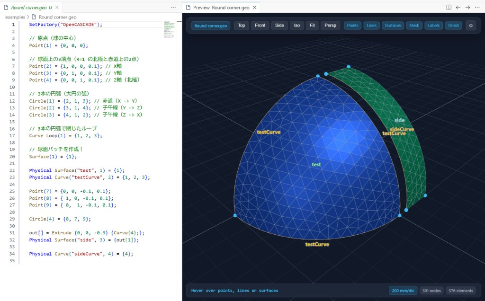
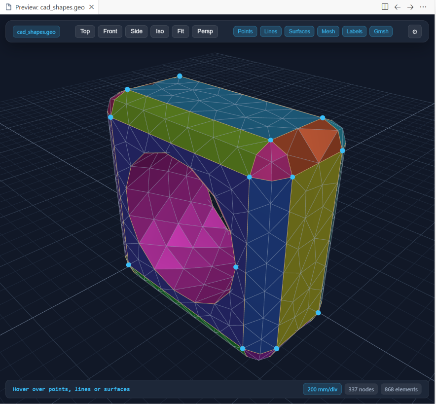

# Gmsh (Language Support & 3D Interactive Preview)

<p align="center">
  
</p>

<p align="center">
  <strong>The definitive Visual Studio Code extension for Gmsh.</strong><br/>
  Featuring comprehensive language support (IntelliSense autocompletion, snippets, hover docs) alongside real-time 3D geometry and finite element mesh visualization.
</p>

<p align="center">
  <a href="https://marketplace.visualstudio.com/items?itemName=Ringo3Apples.gmsh-preview"></a>
  <a href="https://open-vsx.org/extension/Ringo3Apples/gmsh-preview"></a>
  <a href="https://github.com/Ringo3apples/gmshExtension/releases"></a>
  <a href="LICENSE"></a>
</p>

<p align="center">
  <a href="#features">Features</a> •
  <a href="#getting-started">Getting Started</a> •
  <a href="#configuration">Configuration</a> •
  <a href="#snippets--shortcuts">Snippets</a> •
  <a href="#japanese-日本語">日本語ドキュメント</a>
</p>

<p align="center">
  
</p>
<p align="center">
  
</p>

---

## ✨ Features

### 1. 🧠 Comprehensive Gmsh Language Support (IntelliSense)
- **Keyword & Primitive Autocompletion**: Instant suggestions for `Point`, `Line`, `Circle`, `Spline`, `Curve Loop`, `Plane Surface`, `Surface`, `Volume`, and OpenCASCADE primitives (`Box`, `Cylinder`, `Sphere`, etc.).
- **Dynamic Variable Detection**: Automatically scans your open `.geo` file to suggest user-defined variables and arrays (e.g., `out[]`, `lc`, `r`).
- **Context-Aware Safety**: Autocompletion is intelligently suppressed inside comments (`//`) to prevent unwanted popup interruptions.
- **Hover Documentation**: Hover over any Gmsh command to view its syntax, parameters, and example code in formatted Markdown.
- **Auto-Closing & Indentation Rules**: Optimized brackets, quotes, and `{}` indentation hierarchy tailored for Gmsh syntax.

### 2. ⚡ Real-Time 3D Geometry & Mesh Preview
- **Live Sync & `Gmsh` / `Mesh` Mode Coupling**: Toggle between pure `.geo` geometry preview (`Gmsh` OFF, showing `P#`/`L#` ID labels without running Gmsh CLI) and full Gmsh execution (`Gmsh` ON, displaying `.msh` geometry, mesh wireframe, and `Physical` entity names).
- **Per-Region Surface Color Coding**: Automatically colors each `Physical Surface` or `Surface` tag using a distinct 12-color CAD palette, with desaturated back faces (60% saturation, 80% lightness) for clear normal orientation recognition.
- **Cursor-Centered Zoom**: Mouse wheel zooming in both Perspective and Orthographic modes centers directly on the 3D point under the cursor.
- **Two-Way Code Navigation**: Click on any point, curve, or surface in the 3D viewport to immediately jump and focus the editor cursor on its definition line!
- **Borderless Smart Labels & Fixed 10px Markers**: Point markers and labels maintain a crisp, constant pixel size regardless of zoom, with line labels dynamically tracking the visible segment center on screen.
- **Origin-Aligned Infinite Adaptive Grid (`mm/div`)**: Smart grid stepping (`1, 2, 5 × 10^n`) anchored at the world origin `(0, 0, 0)` with major 5-division lines and `mm/div` scale indicator on the status bar.
- **Display Toggles & Multi-Angle Camera**: Easily toggle points, curves, surfaces, mesh wireframe, and labels, with instant presets for Top, Front, Side, Isometric, Fit-to-Screen, and Perspective / Orthographic projection.
- **Automatic `.msh` Output**: Automatically writes `<filename>.msh` alongside your `.geo` file whenever Gmsh succeeds.

---

## 🚀 Getting Started

### Installation

#### Method 1: Visual Studio Code Marketplace (Recommended for VS Code)
Search for **`Gmsh`** or **`gmsh-preview`** in the Extensions view (`Ctrl+Shift+X` / `Cmd+Shift+X`) and click **Install**.

Or install directly from your terminal:
```bash
code --install-extension Ringo3Apples.gmsh-preview
```
👉 [View on Visual Studio Marketplace](https://marketplace.visualstudio.com/items?itemName=Ringo3Apples.gmsh-preview)

#### Method 2: Open VSX Registry (Recommended for VSCodium, Gitpod, Theia)
Search for **`gmsh-preview`** in the Open VSX Extensions view, or install from the terminal:
```bash
codium --install-extension Ringo3Apples.gmsh-preview
```
👉 [View on Open VSX Registry](https://open-vsx.org/extension/Ringo3Apples/gmsh-preview)

#### Method 3: Install from GitHub Releases (.vsix)
1. Download the latest `gmsh-preview-*.vsix` from [GitHub Releases](https://github.com/Ringo3apples/gmshExtension/releases).
2. In VS Code, open Extensions (`Ctrl+Shift+X` / `Cmd+Shift+X`).
3. Click the **`...`** (Views and More Actions) menu in the top right, then select **Install from VSIX...** (or simply drag and drop the `.vsix` file into the VS Code window).

#### Method 4: Build and Install from Source
```bash
git clone https://github.com/Ringo3apples/gmshExtension.git
cd gmshExtension
npm install
npm run build
npm run package
code --install-extension gmsh-preview-*.vsix
```

---

### Usage
1. Open any `.geo` or `.msh` file. The language mode is automatically set to **Gmsh**.

### Opening the 3D Preview
Choose any of these methods:
- Click the **eye icon** (`$(eye)`) at the top-right corner of the editor title bar.
- Click **`$(eye) Gmsh Preview`** in the status bar (bottom right).
- Press `Ctrl+Shift+P` (or `Cmd+Shift+P` on macOS) and run:
  ```text
  Gmsh: Open 3D Realtime Preview to the Side
  ```

### Automatic Gmsh CLI Detection
The extension automatically searches common system paths, `C:\Program Files\gmsh*`, Conda environments, Downloads, and system `PATH` for the `gmsh` executable:
- When found, you will be prompted to save it to your settings.
- To re-scan manually: Run `Gmsh: Auto-Detect Gmsh Executable` in the command palette.
- To select manually: Run `Gmsh: Browse for Gmsh Executable...`.

---

## ⚙️ Configuration (`settings.json`)

| Setting | Type | Default | Description |
| :--- | :--- | :--- | :--- |
| `gmsh.executablePath` | `string` | `"gmsh"` | Path to the Gmsh executable (e.g., `gmsh` or `C:\gmsh\gmsh.exe`) |
| `gmsh.meshDimension` | `number` | `2` | Default mesh dimension (`0`: Geometry, `1`: 1D, `2`: 2D, `3`: 3D) |
| `gmsh.debounceDelay` | `number` | `400` | Delay (ms) after code edits before refreshing the preview |

---

## ⌨️ Snippets & Shortcuts

Type the prefix and press `Tab` or `Enter` to expand:

| Prefix | Expands To | Description |
| :--- | :--- | :--- |
| `Point` | `Point(1) = {x, y, z, lc};` | Point primitive |
| `Line` | `Line(1) = {start, end};` | Line segment |
| `Circle` | `Circle(1) = {start, center, end};` | Circular arc |
| `Curve Loop` | `Curve Loop(1) = {c1, c2, ...};` | Closed curve boundary |
| `Plane Surface` | `Plane Surface(1) = {loop1};` | Planar surface |
| `Surface Loop` | `Surface Loop(1) = {s1, s2, ...};` | Enclosed surface shell |
| `Volume` | `Volume(1) = {loop1};` | 3D Volume |
| `Extrude` | `Extrude {dx, dy, dz} { ... };` | Translation extrusion |
| `Rotate` | `Rotate { {ax,ay,az}, {px,py,pz}, angle } { ... }` | Rotation transform |
| `Box` | `Box(1) = {x, y, z, dx, dy, dz};` | OpenCASCADE 3D box |
| `Cylinder` | `Cylinder(1) = {x, y, z, dx, dy, dz, r};` | OpenCASCADE cylinder |
| `Sphere` | `Sphere(1) = {x, y, z, r};` | OpenCASCADE sphere |
| `BooleanDifference` | `BooleanDifference(1) = { ... } { ... };` | OpenCASCADE Boolean cut |
| `MeshSize` | `MeshSize {points} = size;` | Prescribed element size |
| `Transfinite Curve` | `Transfinite Curve {curves} = n;` | Structured 1D discretization |
| `For` | `For i In {1:10} ... EndFor` | Loop iteration |
| `If` | `If (cond) ... EndIf` | Conditional branch |
| `Printf` | `Printf("value: %g", var);` | Formatted console output |

---

## 🇯🇵 日本語

[Gmsh](https://gmsh.info/) のジオメトリスクリプト（`.geo`）およびメッシュファイル（`.msh`）に対応した VS Code 拡張機能です。
構文ハイライト・入力補完・スニペット・ホバー解説といった**言語サポート**と、Three.js を用いた**リアルタイム 3D プレビュー・双方向コードジャンプ**を1つの拡張機能に統合しています。

- **IntelliSense 補完**: `Point`, `Circle`, `Extrude`, `MeshSize` 等の主要コマンドおよびファイル内で定義した変数を自動補完。
- **ホバー表示**: コマンドの上にマウスを置くだけで構文仕様・引数の意味・使用例を表示。
- **Gmsh / Mesh モード切替 & 自動 `.msh` 出力**: Gmshオフ時は `.geo` の形状と `P1`/`L1` ラベルを高速表示し、Gmshオン時は `.msh` を同フォルダに自動出力して Physical 名ラベルやメッシュを表示。
- **領域ごとの Surface 色分け表示**: `Physical Surface` または Surface タグごとに CAD カラーパレットで自動色分け（裏面は彩度60%・明度80%で法線向きを判別可能）。
- **マウスカーソル中心ズーム**: Perspective / Ortho の両方でマウスカーソル位置を中心に拡大・縮小。
- **画面固定サイズのスマートラベル & 10px 点マーカー**: ズーム倍率に関わらず一定サイズを維持し、線の画面内中央に枠なしで見やすく配置。
- **原点基準のアダプティブグリッド (`mm/div`)**: 原点 `(0, 0, 0)` を基準に `1, 2, 5 × 10^n` 単位で自動調整され、ステータスバーに `mm/div` スケールを表示。
- **Gmsh 自動検出**: お使いの PC 内の `gmsh.exe` を自動検出するため、環境変数の事前設定が不要です。

#### インストール方法（日本語）

##### 方法 1: Visual Studio Code マーケットプレイスからインストール（推奨）
VS Code の拡張機能ビュー（`Ctrl+Shift+X`）で **`gmsh-preview`** または **`Gmsh`** を検索し、「**インストール**」をクリックします。
ターミナルから直接インストールすることも可能です：
```bash
code --install-extension Ringo3Apples.gmsh-preview
```
👉 [Visual Studio Marketplace で見る](https://marketplace.visualstudio.com/items?itemName=Ringo3Apples.gmsh-preview)

##### 方法 2: Open VSX レジストリからインストール（VSCodium / Gitpod / Eclipse Theia 等）
VSCodium 等の拡張機能ビューから **`gmsh-preview`** を検索してインストール、またはターミナルから：
```bash
codium --install-extension Ringo3Apples.gmsh-preview
```
👉 [Open VSX Registry で見る](https://open-vsx.org/extension/Ringo3Apples/gmsh-preview)

##### 方法 3: GitHub Releases (.vsix) からの手動インストール
1. [GitHub Releases](https://github.com/Ringo3apples/gmshExtension/releases) から最新の `gmsh-preview-*.vsix` パッケージをダウンロードします。
2. VS Code の拡張機能ビュー（`Ctrl+Shift+X`）の右上「**…**」メニューから「**VSIX からのインストール...**」を選択します（またはファイルを VS Code ウィンドウへドラッグ＆ドロップ）。

---

## 🛠️ Development & Building

```bash
# Clone the repository
git clone https://github.com/Ringo3apples/gmshExtension.git
cd gmshExtension

# Install dependencies
npm install

# Build the extension and Webview bundle
npm run build

# Watch mode for rapid development
npm run watch

# Type-check TypeScript
npm run compile
```

Press **`F5`** in VS Code to launch the Extension Development Host window for live debugging.

---

## 📄 License

This extension is licensed under the [MIT License](LICENSE).
